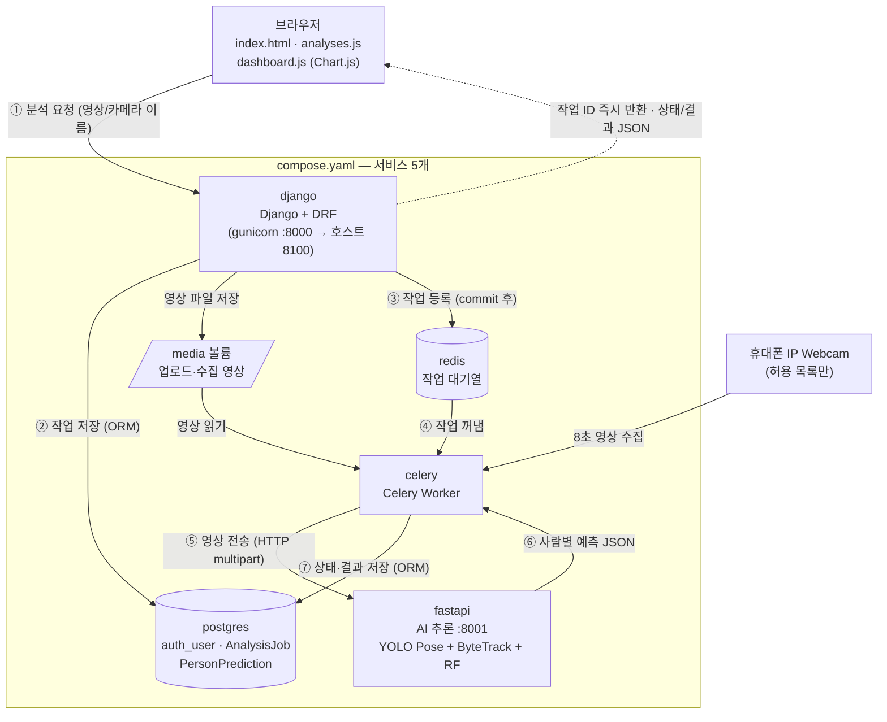
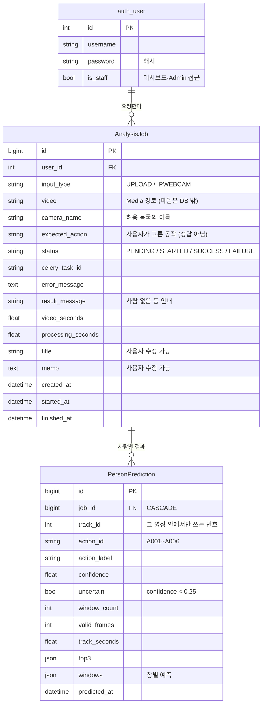
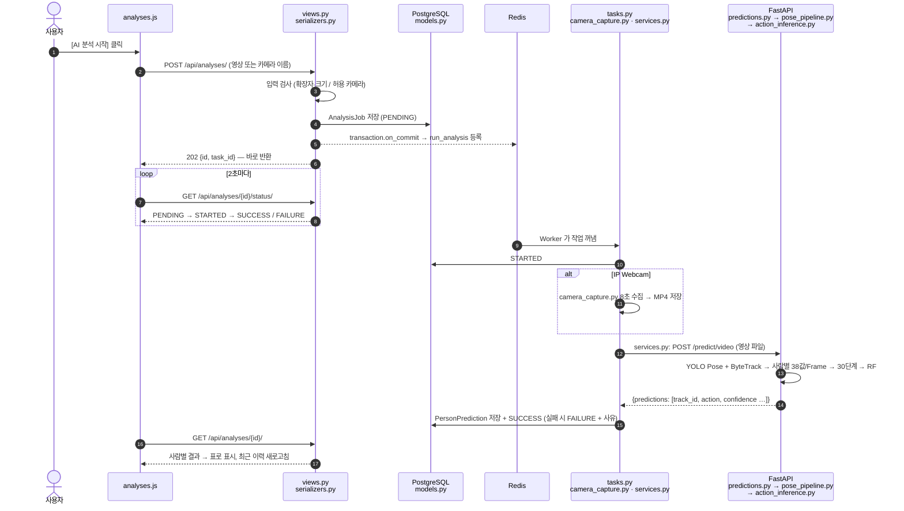
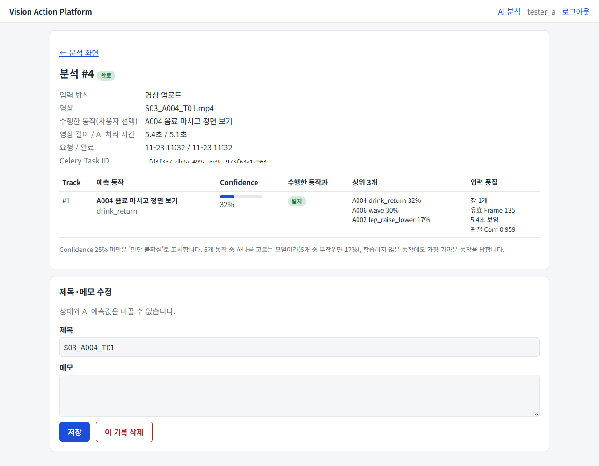
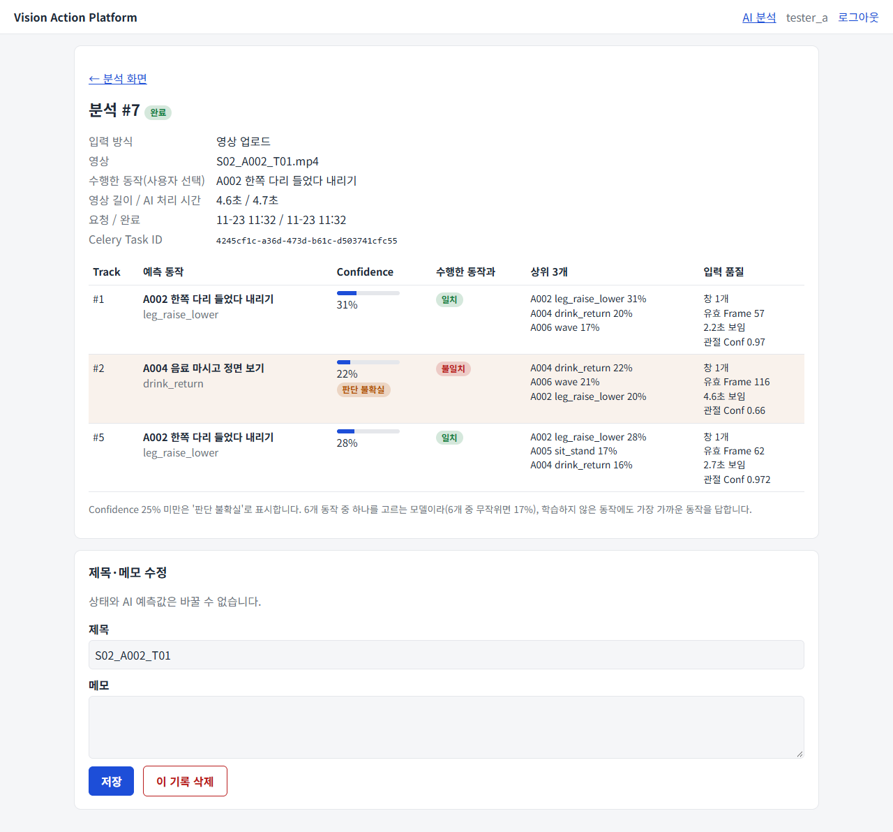
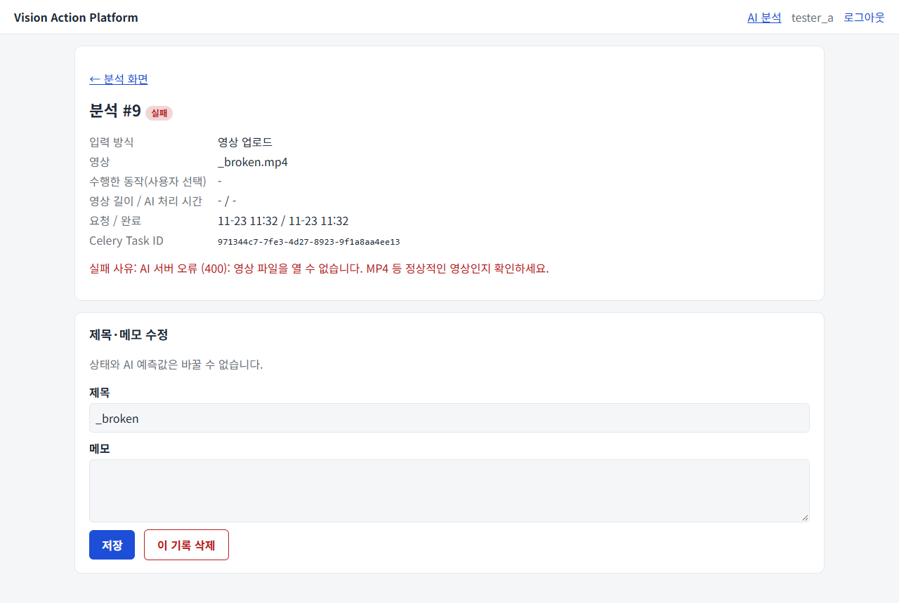
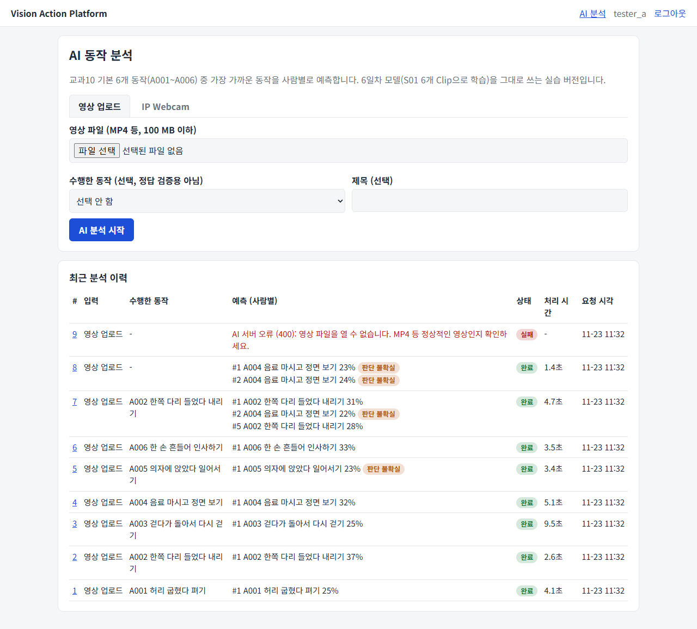
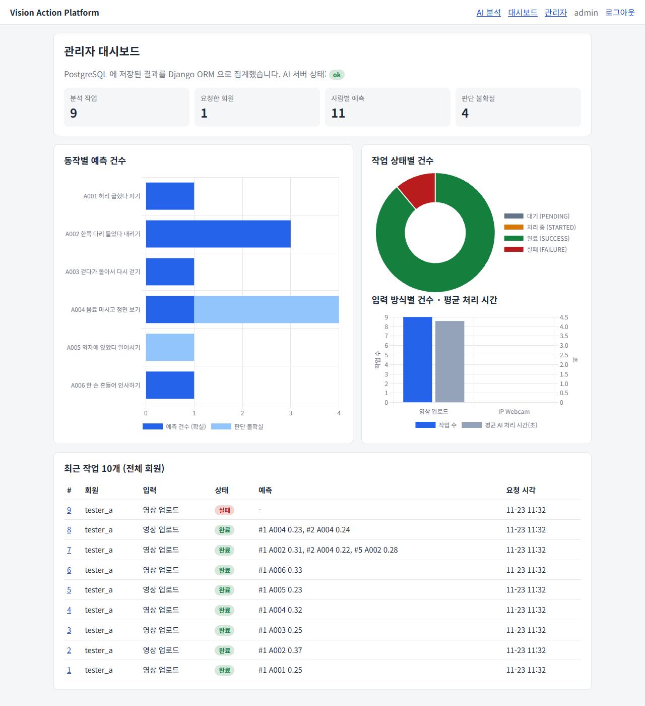
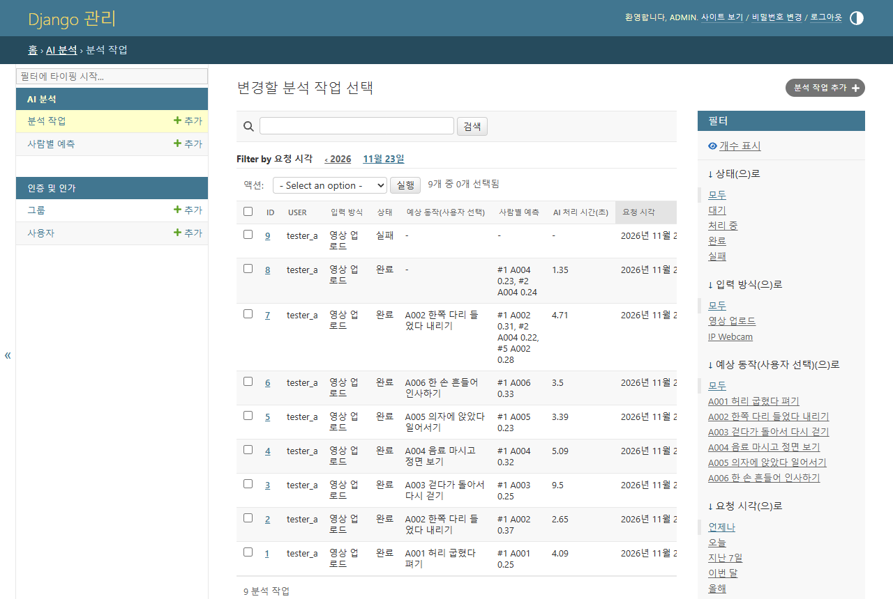

# Vision Action Platform (교과10 최종 프로젝트 — 기본 6개 Action 실습 버전)

영상 속 **사람마다 교과10 기본 6개 동작 중 무엇에 가까운지** 예측해 기록·조회하는 웹 서비스입니다.
1~8일차에 만든 모델과 코드(6일차 Random Forest, 7일차 창 규칙, 8일차 ByteTrack)를 그대로 가져와 Django·DRF·Celery·FastAPI·Docker 로 연결했습니다.

> 같은 서비스를 **3팀이 직접 찍은 17개 동작 데이터**로 바꾼 버전은 [store-anomaly-service](https://github.com/wlgptjd333/store-anomaly-service) 에 있습니다.
> 이 폴더는 수업 순서대로 "먼저 수업 모델로 실습"한 버전이라, 모델과 창 설정만 다르고 웹 구조는 같습니다.

## 1. 프로젝트 소개

- 로그인한 사용자가 **영상 업로드** 또는 **IP Webcam(휴대폰 카메라에서 8초 수집)** 으로 분석을 요청하면,
  YOLO Pose + ByteTrack 으로 사람을 추적하고 사람별로 **6개 동작 중 가장 가까운 동작과 Confidence** 를 보여 줍니다.
- 분석은 Celery 가 백그라운드에서 처리하므로, 요청하자마자 작업 ID를 받고 화면이 상태(대기 → 처리 중 → 완료/실패)를 따라갑니다.
- 결과는 PostgreSQL 에 남고, 관리자는 Django Admin 과 `/dashboard/`(Chart.js)에서 전체 기록·통계를 봅니다.
- 6개 중 하나를 반드시 고르는 모델이라 학습하지 않은 동작에도 답을 내므로, Confidence 25% 미만은 `판단 불확실`로 표시합니다.

| ID | 동작 (label) | 설명 |
|---|---|---|
| A001 | bend_return | 허리를 앞으로 굽혔다가 다시 똑바로 선다 |
| A002 | leg_raise_lower | 한쪽 다리를 들어 올렸다가 다시 내린다 |
| A003 | walk_turn_walk | 걷다가 방향을 바꾸고 다시 걷는다 |
| A004 | drink_return | 음료를 마신 후 다시 정면을 바라본다 |
| A005 | sit_stand | 의자에 앉았다가 다시 일어선다 |
| A006 | wave | 한 손을 들어 흔들어 인사한다 |

## 2. 실행 방법

필요한 것: Docker Desktop(Compose v2). GPU 는 필요 없습니다(AI 서버는 CPU 로 추론).

```bash
git clone https://github.com/wlgptjd333/vision-ai-lab.git
cd vision-ai-lab/subject10_pose_action/vision_action_platform

# 1) 환경변수: 예시를 복사한 뒤 비밀값과 카메라 주소를 직접 채운다 (.env 는 Git 에 올라가지 않음)
cp .env.example .env
#    DJANGO_SECRET_KEY, POSTGRES_PASSWORD  → 긴 무작위 문자열
#    IPWEBCAM_CAMERAS                      → phone=http://<휴대폰 IP>:8080/video  (허용할 카메라만)

# 2) 빌드·실행 (서비스 5개). 처음엔 PyTorch(CPU) 등을 받느라 몇 분 걸린다
docker compose up -d --build

# 3) 마이그레이션 — django 컨테이너가 시작할 때 자동으로 migrate 한다. 직접 하려면:
docker compose exec django python manage.py migrate

# 4) 관리자 계정
docker compose exec django python manage.py createsuperuser
```

| 화면 | 주소 |
|---|---|
| 사용자 (회원가입·로그인 → AI 분석) | http://localhost:8100/ |
| 관리자 대시보드 (is_staff 만) | http://localhost:8100/dashboard/ |
| Django Admin | http://localhost:8100/admin/ |
| FastAPI 문서 (개발용, 이 컴퓨터에서만) | http://localhost:8101/docs |

포트를 8100·8101 로 둔 이유: 우리 데이터 버전(8000·8001)과 동시에 띄워 비교하려고. 컨테이너 안 포트는 같습니다(8000·8001).

**모델 파일 위치** — `ai_service/models/` (6일차 `artifacts/day06/` 를 그대로 복사)

| 파일 | 내용 | Git |
|---|---|---|
| `rf_action_baseline.joblib` | 6일차 Random Forest (6 Class, 300그루, 0.4 MB) | 포함 |
| `rf_feature_columns.json` | 입력 1,140개 Feature 이름·순서 (`t00_nose_x` … `t29_right_knee_angle`) | 포함 |
| `rf_training_info.json` | Class 이름, 30단계, 최소 유효 Frame 10, 학습 Clip 6개(S01) | 포함 |
| `action_classes.csv` | Class label → A001~A006 · 설명 (`configs/action_classes.csv` 복사) | 포함 |
| `yolo11n-pose.pt` | YOLO Pose 가중치 (Ultralytics) | 제외 — Docker 빌드 때 자동으로 받음 |

로컬(도커 없이) 테스트: `cd backend && pip install -r requirements.txt && python manage.py test` (SQLite·가짜 AI 서버로 18개).
AI 서버만 확인: `cd ai_service && python check_predict.py <영상.mp4> ...` (서버를 띄우지 않고 `/health`·`/predict/video` 호출).

## 3. 전체 아키텍처



- **PostgreSQL 은 Django ORM 으로만** 씁니다. FastAPI 는 DB 를 모르고, 영상을 받아 JSON 만 돌려줍니다.
- 컨테이너끼리는 `localhost` 가 아니라 서비스 이름(`postgres`, `redis`, `fastapi`)으로 부릅니다.
- 공개 포트는 django 하나. fastapi 는 개발 확인용으로 `127.0.0.1` 에만 엽니다.
- Django 와 Celery 는 같은 이미지(`backend/Dockerfile`)를 쓰고 실행 명령만 다릅니다. 업로드 영상은 `media` 볼륨을 함께 씁니다.

## 4. DB 설계 (ERD)



| 테이블 | 저장하는 것 | 작성 위치 |
|---|---|---|
| `auth_user` | 회원 (Django 기본) | Django 제공 |
| `AnalysisJob` | 분석 요청 1건: 누가, 어떤 입력으로, 지금 상태, 실패 사유, 처리 시간 | `backend/analyses/models.py` |
| `PersonPrediction` | 그 요청 영상 속 사람 1명의 예측. 두 사람이면 작업 1건에 2행 (`(job, track_id)` 유일) | `backend/analyses/models.py` |

- 영상 파일은 DB 에 넣지 않고 Media 폴더에 두며 경로만 저장합니다. 기록을 지우면 사람별 예측(CASCADE)과 영상 파일도 함께 지웁니다.
- 일반 사용자는 **제목·메모만** 고칠 수 있습니다. 상태·예측값을 사용자가 바꾸면 기록과 통계를 믿을 수 없게 되기 때문입니다.

## 5. AI 추론 버튼 구현 흐름



| 단계 | 파일 |
|---|---|
| 입력 화면·탭 전환·상태 조회·결과 표 | `backend/templates/analyses/index.html`, `backend/static/js/analyses.js` |
| 요청 접수·권한·작업 등록 | `backend/analyses/views.py`, `serializers.py`, `permissions.py` |
| 백그라운드 처리 | `backend/analyses/tasks.py`, `camera_capture.py`, `services.py` |
| 추론 API | `ai_service/main.py`, `routers/predictions.py` |
| 영상 → 사람별 Feature | `ai_service/services/pose_pipeline.py` → `src/multi_person_utils.feature_from_keypoints` (8일차) |
| 30단계 변환·예측 | `ai_service/services/action_inference.py` → `src/sequence_utils.resample_sequence` (6일차) |
| 모델 로드·검사 | `ai_service/services/model_loader.py` |
| 대시보드 집계·차트 | `backend/analyses/page_views.py`, `backend/static/js/dashboard.js` |

## 6. 사용한 모델과 입력 형식

**6개 Action 모델 재사용** — 1~8일차 코드에서 가져온 것과 서비스에서 새로 정한 것을 나눴습니다.

| 단계 | 내용 | 출처 |
|---|---|---|
| Pose | `yolo11n-pose.pt`, imgsz 640, 사람 conf 0.25 | 1~3일차 |
| 추적 | ByteTrack (`bytetrack.yaml`) — 사람마다 `track_id` | 8일차 `configs/day08_multi_person.json` |
| Frame Feature 38개 | 어깨 폭으로 정규화한 17관절 x,y (34) + 팔꿈치·무릎 각도 4 | `src/multi_person_utils.feature_from_keypoints` 그대로 |
| Sequence | 유효 Frame 을 시간 0~1 로 펴서 30단계로 보간 → 30 × 38 = **1,140** | `src/sequence_utils.resample_sequence` 그대로 |
| 창 준비 규칙 | 창 시간 ≥ 창 길이 × 0.8 · 유효 Frame 비율 ≥ 0.6 · 유효 Frame ≥ 10 | 7일차 `configs/day07_realtime.json` |
| 창 길이 | 12초 (사람이 12초 이하로 보이면 전체가 창 1개), 더 길면 4초씩 밀며 확률 평균 | **서비스에서 새로 정함** (아래) |
| 판단 불확실 | 평균 확률 1위 < 0.25 | **서비스에서 새로 정함** (아래) |
| 모델 | Random Forest 300그루, 6 Class, S01 6개 Clip 으로 학습 | 6일차 `artifacts/day06/` |

`src/` 의 5개 파일(`pose_utils`, `feature_utils`, `sequence_utils`, `realtime_utils`, `multi_person_utils`)은 수업 저장소에서 그대로 복사했습니다.
서버가 시작할 때 `model_loader.py` 가 Joblib 입력 수(1,140) · Feature 순서(`t00~t29 × 38`) · Class 순서 · Action 목록을 서로 맞춰 보고, 틀리면 `/health` 에 이유를 띄웁니다.

**학습과 같은 계산인지 확인** — 6일차 오프라인 평가(`data/day06/sequences/test.csv`)와 서비스 결과를 Test 영상(S03) 6개로 비교했습니다.
창이 학습 모양(Clip 전체)과 같을 때 6개 모두 **예측과 Confidence 가 소수 둘째 자리까지 같았습니다** (예: A002 0.37, A006 0.33).

**창 길이를 7일차 5초가 아니라 12초로 한 이유**

| 창 | Test S03 정답 | 틀린 것 |
|---|---|---|
| 7일차 5초 창 (1초씩 이동) | 4 / 6 | A003 (10.7초 영상 → A004), A004 (5.4초 → A006) |
| 12초 창 (짧은 영상은 전체 1개) | **6 / 6** | 없음 |

- 6일차 모델은 **Clip 전체**(2.5~10.7초)를 30단계로 펴서 학습했습니다. 5초 창은 그보다 긴 동작(걷고 돌아서 걷기)을 잘라 다른 모양이 됩니다.
- 7일차 5초 창은 웹캠에서 "지금 하는 동작"을 계속 보여 주는 용도였고, 이 서비스는 업로드된 영상 한 편의 결과를 내므로 학습과 같은 모양을 택했습니다.
- 12초는 가장 긴 학습·검증·Test Clip(10.7초)보다 조금 긴 값입니다. 60초 영상처럼 긴 입력은 12초 창 여러 개의 평균이 됩니다.

**판단 불확실 기준을 7일차 0.55 가 아니라 0.25 로 한 이유**

- 6개 Clip 으로만 학습한 모델이라 확률이 낮게 나옵니다. Test 6개 중 가장 높은 Confidence 가 0.37 이라, 0.55 를 쓰면 **모든 결과가 불확실**이 됩니다.
- 기준은 Test 가 아니라 Validation(S02)에서 정했습니다: 6일차 오프라인 평가에서 맞힌 3개가 0.30~0.32, 틀린 3개가 0.21~0.23 → 사이 값 0.25.
- 무작위로 고르면 1/6 ≈ 0.17 이므로, 0.25 는 "무작위보다 조금 나은" 정도의 약한 기준입니다. 결과는 참고용입니다.

**입력 영상**: mp4·mov·avi·mkv·webm, 100 MB 이하, 처음 60초까지. 60fps 는 30fps 로 줄여 처리.
**IP Webcam**: `.env` 에 등록한 카메라만 이름으로 고르고, Worker 가 **8초** 동안 받아 MP4 로 저장한 뒤 같은 추론을 탑니다.

FastAPI `POST /predict/video` 응답 (발췌, Test `S03_A004_T01.mp4`):

```json
{
  "ok": true, "message": "",
  "video": {"frames": 135, "fps": 25.0, "seconds": 5.4, "width": 640, "height": 480},
  "uncertain_below": 0.25,
  "predictions": [
    {"track_id": 1, "action_id": "A004", "action_label": "drink_return",
     "action_name_ko": "음료를 마신 후 다시 정면을 바라본다",
     "confidence": 0.32, "uncertain": false, "window_count": 1, "valid_frames": 135,
     "top3": [{"action_id": "A004", "probability": 0.32}, {"action_id": "A006", "probability": 0.29},
              {"action_id": "A002", "probability": 0.17}]}
  ],
  "skipped_tracks": []
}
```

| 상황 | 응답 | Worker 처리 |
|---|---|---|
| 정상 | 200 + predictions | SUCCESS + 사람별 저장 |
| 사람 없음·관절이 거의 안 보임 | 200 + 빈 predictions + message | SUCCESS + 안내 문구 |
| 영상을 열 수 없음·형식 오류 | 400 + detail | FAILURE + 사유 |
| 모델 준비 안 됨 | 503 | FAILURE + 사유 |
| AI 서버 연결 실패·시간 초과 | — | FAILURE + 사유 |

## 7. 실행 결과와 검증

**정상 분석** — 입력: Test `S03_A004_T01.mp4`(음료 마시기, 5.4초) → 예측 A004, Confidence 32%, 일치.



**여러 사람 (T04)** — 입력: Validation `S02_A002_T01.mp4`(다리 들기, 오른쪽 뒤에 작게 잡힌 사람이 내내 제자리에 있음) → 한 작업에 Track 3개.
동작한 사람은 Track #1(1~57 Frame)·#5(49~116 Frame)로 나뉘었고(같은 자리에서 ID 가 새로 붙음, 아래 한계) 둘 다 A002 로 맞혔습니다. 뒷사람 #2 는 22% 로 `판단 불확실`.



**오류·실패** — 입력: 이름만 `.mp4` 인 손상 파일 → AI 서버가 400, 작업은 `실패` 와 사유로 저장.



**사용자 화면** — 업로드 / IP Webcam 탭, 최근 이력



**관리자 대시보드** — 동작별 예측 건수(옅은 색 = 판단 불확실), 작업 상태별 건수, 입력 방식별 건수·평균 처리 시간



**Django Admin** — 상태·입력 방식·예상 동작 필터, 사용자 검색, 사람별 예측 Inline



### 과제 테스트 (T01~T10)

| 테스트 | 확인 방법 | 결과 |
|---|---|---|
| T01 모델 불러오기 | `GET /health` — 파일 4개 교차 확인 | 6 Class · 1,140 Feature (30 × 38) · ready |
| T02 영상 업로드 | `scripts/e2e_check.py` (Docker, 세션 로그인 → API), Test S03 6개 | PENDING → STARTED → SUCCESS, **6개 모두 일치** (A005 는 23% 로 불확실 표시) |
| T03 IP Webcam | 휴대폰 IP Webcam 앱으로 8초 수집 | 시연 때 확인 예정 (연결 실패 처리는 단위 테스트로 확인) |
| T04 사람별 결과 | S02 다리 들기(뒤에 다른 사람), 8일차 SBU 포옹(2명) | 작업 1건에 Track 별로 따로 저장 (3개 / 2개) |
| T05 비동기 | 업로드 POST 응답 시간 | 0.02~0.1초에 202 + 작업 ID (분석은 1~10초 뒤 완료) |
| T06 영구 저장 | 새로고침·상세 재조회 | 같은 결과 |
| T07 CRUD 권한 | 회원 B 가 A 의 작업 조회/수정/삭제 | 404 / 404 / 404, B 목록 0건. A 의 PATCH 는 제목·메모만, PUT 405 |
| T08 관리자 | admin 으로 `/dashboard/`, 일반 회원 | 200 / 관리자 로그인으로 이동 |
| T09 예외 처리 | 손상 파일, `.txt`, 허용 안 된 카메라 URL, Redis·AI 서버 끊김 | FAILURE + 사유 / 400 (DB 저장 전 거절) |
| T10 Docker 재시작 | `docker compose down` → `up` | 작업 9건·예측 11건 그대로 |

Django 단위 테스트 18개(`backend/accounts/tests.py`, `backend/analyses/tests.py`)는 AI 서버와 카메라를 가짜로 바꿔 위 흐름을 확인합니다.

### 만난 문제와 해결

| 증상 | 확인한 곳 | 바꾼 것 | 확인 |
|---|---|---|---|
| 7일차 5초 창으로 Test 6개 중 2개 틀림 | 틀린 2개가 5초보다 긴 영상, 6일차 오프라인 평가는 6/6 | 창을 학습 Clip 모양에 맞춰 12초로 (위 6장) | 6/6, Confidence 오프라인과 같음 |
| 7일차 기준 0.55 로는 결과가 전부 `판단 불확실` | Test 최고 Confidence 0.37 | Validation 맞힘/틀림 사이 값 0.25 | Test 6개 중 1개만 불확실 |
| `docker` 명령이 WSL 에서 안 됨 | Docker Desktop 이 꺼져 있었음 | Docker Desktop 실행 | 엔진 29.8 정상 |

## 폴더 구조

```text
vision_action_platform/
├── compose.yaml            서비스 5개 (django · fastapi · celery · redis · postgres)
├── .env.example            변수 이름과 자리표시자 (실제 .env 는 Git 제외)
├── backend/                Django + DRF + Celery (같은 이미지)
│   ├── config/             settings · urls · celery
│   ├── accounts/           회원가입 (로그인·로그아웃은 Django 기본 뷰)
│   ├── analyses/           models · serializers · views · tasks · services · camera_capture · admin · page_views
│   ├── templates/ static/  화면 · analyses.js · dashboard.js · app.css
│   └── Dockerfile
├── ai_service/             FastAPI
│   ├── main.py routers/ services/
│   ├── src/                [복사] pose_utils · feature_utils · sequence_utils · realtime_utils · multi_person_utils
│   ├── models/             6일차 Joblib · Feature 순서 · 학습 정보 · Action 목록
│   └── Dockerfile
├── scripts/                e2e_check.py (Docker 통합 확인) · capture_screens.py (README 캡처)
└── docs/images/            README 캡처 (얼굴·비밀번호·카메라 주소 없음)
```

## 한계

- 모델이 **S01 한 사람의 6개 Clip** 으로만 학습됐습니다. Validation(S02) 은 6일차 평가에서 6개 중 3개만 맞혔고, Test(S03) 6/6 도 6개뿐이라 정확도 근거로는 약합니다.
  더 많은 사람·반복 촬영이 필요하고, 그 방향으로 3팀 데이터(5명 × 17동작)로 바꾼 것이 [store-anomaly-service](https://github.com/wlgptjd333/store-anomaly-service) 입니다.
- ByteTrack 이 같은 사람에게 새 ID 를 붙이면 한 사람이 두 줄로 나옵니다 (S02 예시 #1·#5). 위치가 겹치는 Track 을 이어 붙이는 처리는 하지 않았습니다.
- 6개 중 하나를 반드시 고르는 구조라 "아무 동작 안 함"이나 학습하지 않은 동작(SBU 포옹 등)도 가장 가까운 동작으로 답합니다. `판단 불확실` 표시와 상위 3개 확률로 함께 판단합니다.
